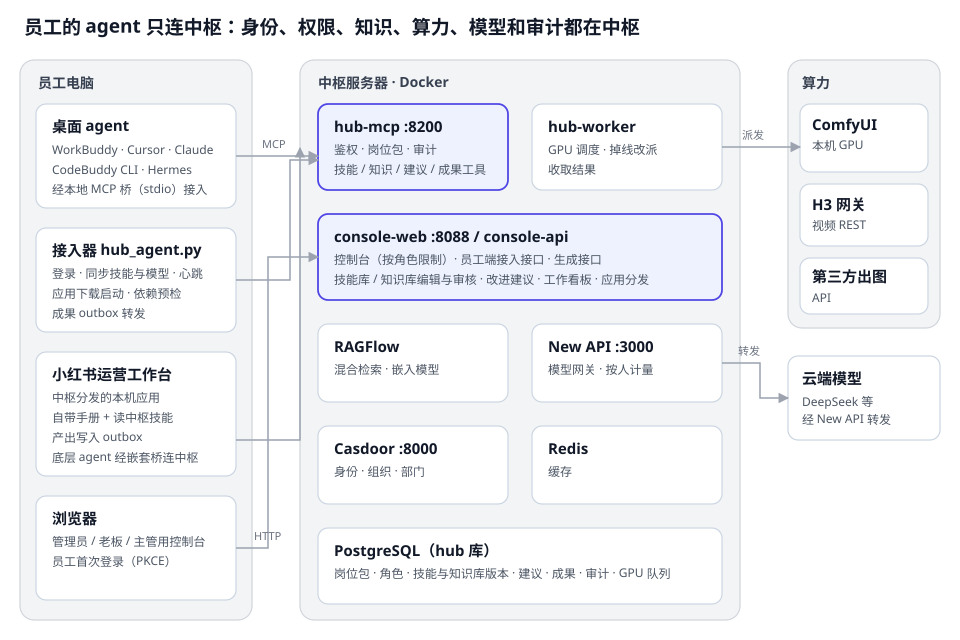

# 3 总体架构

系统由三个物理位置组成：员工电脑、中枢服务器、GPU 与外部算力。员工的 agent **只与中枢通信**；中枢内部的各服务通过 Docker 网络互联，对外只暴露必要端口。

## 3.1 逻辑分层

| 层 | 职责 | 组件 |
|---|---|---|
| 接入层 | 把员工的 agent 接到中枢：登录、配置与技能下发、协议桥接、应用分发 | 接入器 `hub_agent.py`、一键安装脚本、console-web（nginx） |
| 控制层 | 身份校验、岗位包权限、控制台角色、治理流程（版本 / 审核 / 建议）、审计、计量、调度决策 | hub-mcp、console-api、hub-worker（自研，同一镜像） |
| 能力层 | 知识检索、模型推理、图像与视频生成 | RAGFlow + TEI、New API → 云端模型、ComfyUI / H3 网关 / 第三方出图 API |
| 数据层 | 配置、内容与版本、审计、任务队列、在线状态 | PostgreSQL 16、Redis 7、MinIO / ES（RAGFlow 内部） |

## 3.2 服务清单

| 服务 | 端口 | 技术 | 说明 |
|---|---|---|---|
| console-web | 8088 | nginx + React | 控制台静态资源；`/api/` 反向代理到 console-api（同源，保证会话 cookie 生效） |
| console-api | 内部 8100 | FastAPI | 控制台 API、员工端接入接口、HTTP 生成接口、应用包下载、签名文件下载 |
| hub-mcp | 8200 | MCP SDK（Streamable HTTP） | 员工 agent 的唯一工具入口 |
| hub-worker | — | Python 常驻进程 | GPU 调度：刷新节点、领取派发、收取结果、容错改派 |
| Casdoor | 8000 | Casdoor 4.20.0 | OAuth2 / OIDC 身份提供方，组织与部门（分组） |
| New API | 3000 | new-api v0.13.2 | OpenAI 兼容模型网关，员工专属 key、模型价格与计量 |
| RAGFlow | 8080 / 9380 | RAGFlow v0.27.2 | 知识库解析与混合检索；TEI 提供嵌入 |
| PostgreSQL / Redis | 25432（本机） | Postgres 16 / Redis 7 | 中枢库 `hub` 与 Casdoor、New API 的库 |
| ComfyUI | 8188（宿主机） | ComfyUI Desktop | 本机 GPU 节点；容器经 `host.docker.internal` 访问 |

## 3.3 关键设计决策（ADR 摘要）

### ADR-1 自研轻量 MCP Server，而非引入现成 MCP 网关

现成网关（ContextForge、Obot 等）的 RBAC 解决的是「能不能调用某个工具」，但中枢的核心需求是「同一个检索工具对不同岗位返回不同的数据」。这种**数据级授权**无论用不用网关都必须写在业务服务里。自研更快，也最容易把追踪 ID 贯穿到审计。工具规模扩大后，可在前面再加一层网关做限流和目录管理，两者并不冲突。

### ADR-2 任务队列放在 PostgreSQL，而非 Celery / Redis 队列

GPU 任务的吞吐很低（每分钟几个），但需要**持久化、可查询、可审计**：控制台要列出排队位置、历史和失败原因。PostgreSQL 的 `SELECT … FOR UPDATE SKIP LOCKED` 已能提供安全的并发领取语义，避免再引入一个中间件和它的运维成本。队列表本身就是任务历史，天然支持统计与额度计算。

### ADR-3 员工端登录走授权码 + PKCE，中枢不代换授权码

员工端是公开客户端，本机不应持有应用密钥。实测发现：带着应用密钥换授权码时，Casdoor 对未带 PKCE 的授权码**不做校验**，被截获的授权码可能被冒用；不带密钥时 Casdoor 必须校验 PKCE。因此员工端直接用 PKCE 向 Casdoor 换令牌，中枢的账号密码接口只在开发环境显式开启。

### ADR-4 权限过滤在检索之前（前置过滤），而非对结果做后置过滤

中枢先按岗位包算出允许的知识库集合，再只把这些库对应的 RAGFlow 数据集 ID 传给检索。后置过滤（先查全部再删除无权结果）有两个问题：一是 top-k 名额会被无权文档占掉，召回质量下降；二是只要过滤逻辑出一次错就会泄露数据。前置过滤让「看不到」成为结构性保证，结果层再加一道「不属于本次允许库的命中一律丢弃」作为纵深防御。

### ADR-5 计费只覆盖经过中枢的资源

各家桌面 agent 自带模型和积分，中枢无法也不应该计量它们的 token。中枢统一计量自己掌握的资源（工具调用、GPU），模型 token 只对使用「中枢模型」的岗位计量。这样新增一种 agent 时计费零改动，额度管控也落在中枢真正承担成本的地方。

### ADR-6 控制台接口默认拒绝，而不是逐个接口声明谁能访问

控制台有三种角色，但接口有几十个，且在持续增加。如果「默认允许、逐个禁止」，每新增一个接口都可能不小心把管理功能暴露给主管。中枢反过来：`/api` 的全局依赖只放行管理员；老板和主管只能用**白名单**里的接口，且主管看到的数据还要再按部门过滤。**新增接口默认只有管理员能用**，要开放必须显式加进白名单，并在处理函数里按角色过滤数据。

### ADR-7 技能和知识库内容存数据库、带版本，磁盘目录只做初始数据

最初技能和知识库是磁盘上的 Markdown（Obsidian + git），业务人员改完要走 git 才能下发。主管无法直接维护，也没有回滚和审核。改为数据库存储后：每次保存是一个新版本，回滚是「用旧内容生成新版本」（历史永远是一条直线），可以在同一套机制上叠加「本部门直接生效 / 全公司审核」和「agent 建议」。代价是不再用 Obsidian / git 维护，备份要备份数据库（9、16 章说明）。

### ADR-8 agent 只提建议，不直接改内容

让 agent 直接改技能等于让一次不确定的对话改变全公司的工作标准。中枢把「发现问题」和「决定修改」分开：agent 只能通过 `propose_improvement` 提交建议（带依据和可选的完整新内容），由负责的主管（全公司内容由老板或管理员）看差异后采纳、修改后采纳或驳回。建议内容被当作不可信输入，只给人看，从不自动执行。

### ADR-9 应用手册与中枢技能叠加，而不是互相替换

小红书运营工作台自带详细的操作手册（数据文件格式、检查点、浏览器与账号安全），中枢又有主管维护的业务技能（口吻、选题标准、合规红线）。两者分工不同：手册管「怎么在工作台里做」，技能管「做到什么标准」。冲突时按固定优先级处理，直接冲突则 agent 先停下来说明，并对技能提改进建议（14 章）。
