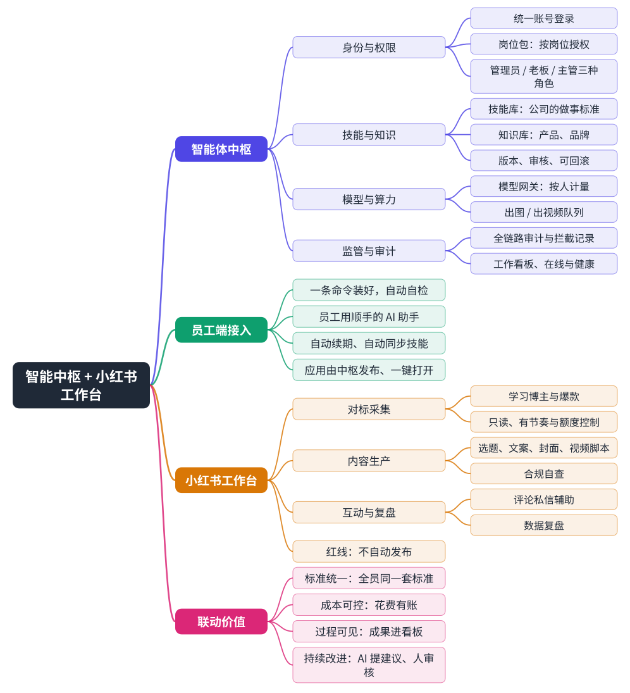

# 3 产品全景

整套系统由三部分组成：**智能体中枢**（部署在公司内网的管理端）、**员工端接入**（让员工电脑接上中枢）、**应用**（按岗位分发的业务工具，小红书运营工作台是第一个）。

## 3.1 角色与分工

| 角色 | 在系统里做什么 |
|---|---|
| 老板 | 看全公司的总览、成果看板、成本和审计；审核全公司级的技能和知识修改 |
| 部门主管 | 管本部门的成员、岗位技能和知识；本部门的修改可以直接生效；审核本部门员工的 AI 提出的改进建议 |
| 管理员 | 建账号、配岗位包、接模型、发布应用、看应用健康；新增的接口默认只有管理员能用 |
| 员工（运营等岗位） | 用自己的 AI 助手和岗位应用干活；自己的助手按岗位包拿到技能、知识和工具 |
| 员工的 AI 助手 | 通过中枢调用技能、知识、出图出视频；上报成果；发现问题只能提建议 |

## 3.2 三个关键概念

- **岗位包**：把「这个岗位能用哪些工具、哪些知识库、哪些模型、能打开哪些应用、月度额度多少」打成一包，按岗位或按人分配。权限由它决定，不靠员工自己的提示词。
- **技能**：公司规定的工作做法，例如选题、写作、封面、合规自查的标准步骤。AI 助手按技能做事，主管在控制台修改并保留版本。
- **应用**：由中枢统一发布、在员工电脑本机运行的程序。员工对 AI 助手说「打开小红书工作台」，中枢先确认权限，再下载、校验、启动。
