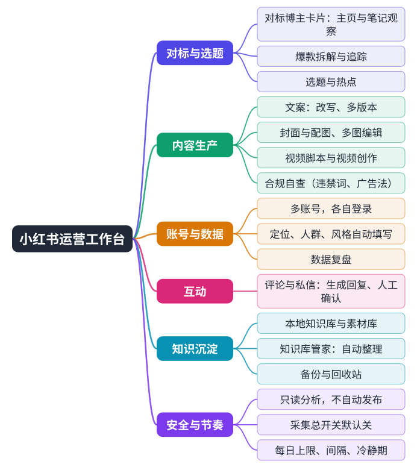

# 5 小红书运营工作台：第一个岗位应用

**定位**：给小红书运营人员用的本机网页工作台，装在员工自己的电脑上，数据存在本机目录。它把「看对手、定选题、写内容、做封面、看数据」放在一个界面里，底层由员工的 AI 助手完成分析和生成，并接入公司中枢取得标准和资料。

## 5.1 主要功能

| 模块 | 做什么 |
|---|---|
| 竞品对标 | 添加对标博主，AI 在员工自己的浏览器里**只读**观察主页和笔记，生成结构化的博主卡片；可做爆款拆解和对标追踪 |
| 选题 | 结合账号定位和热点给出选题 |
| 文案 | 生成和改写笔记文案，支持多版本；自动做合规自查（违禁词、广告法） |
| 封面与配图 | 封面、配图、多图编辑；图片和视频走中枢的出图出视频队列 |
| 视频 | 视频脚本和视频创作 |
| 互动 | 评论和私信辅助：生成回复建议，由人确认 |
| 账号与数据复盘 | 多账号各自登录；根据主页自动填好账号的定位、目标人群和内容风格（只填空白处，可再改）；数据复盘 |
| 知识沉淀 | 本地知识库和素材库，知识库管家可自动整理；有备份和回收站 |

## 5.2 刻意设置的边界

用户（公司）对这个工作台提出的硬性要求，已经落实在产品里：

- **只做只读分析，不自动发布**。学习博主、分析数据可以自动化；发布到小红书由员工自己确认并完成。
- **采集只走 WorkBuddy 浏览器插件**，在员工自己的浏览器里进行，不使用后台浏览器直连。
- **采集节奏受控**：采集总开关默认关闭，由运营本人打开；有每天笔记 / 主页上限、两次采集的间隔、允许时段，遇到平台提示可以设冷静期。
- **权限分档**：浏览器权限默认是只读档（只能看、滚动、截图），更高权限需要明确授权。

> 需要说明：这些措施控制的是读取量和行为边界，**不能保证平台不会对账号采取风控措施**。平台规则变化和账号状态属于外部因素。

## 5.3 版本与发布

工作台随中枢发布：每次升级版本号后上传到中枢的应用目录即可，不需要重启中枢。员工双击桌面图标就会自动升级到新版（旧版本空闲才会被替换，有任务在跑时不打断）。目前版本 v0.8.26，已在员工电脑试用并持续根据反馈修复。
