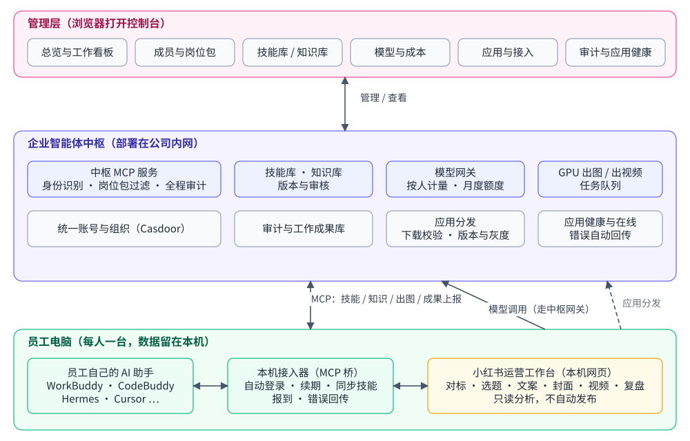
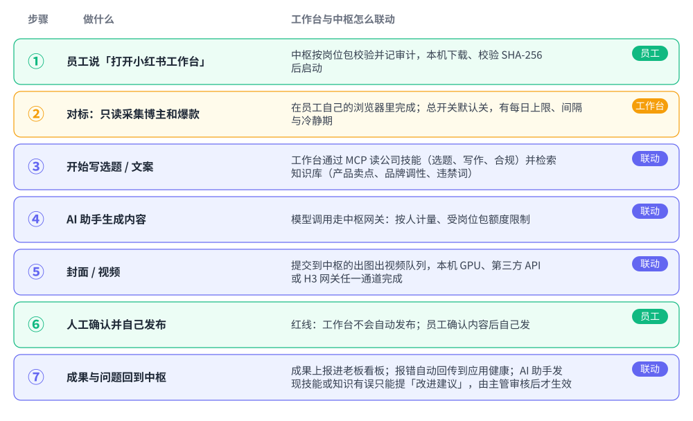

# 6 中枢与工作台如何联动

工作台不是孤立的工具：它借助中枢拿到公司的标准、资料、模型和算力，又把成果、错误和在线状态回报给中枢。中枢负责「管」，工作台负责「做」。

## 6.1 一次运营任务的联动流程

## 6.2 联动点一览

| 联动点 | 谁给谁 | 效果 |
|---|---|---|
| 应用分发与升级 | 中枢 → 工作台 | 岗位包决定谁能打开；下载后校验指纹；员工双击图标自动升到新版；老板不用逐台电脑去装 |
| 公司技能 | 中枢 → 工作台 | 选题、写作、封面、合规自查按公司标准做；主管改了技能，全员下次使用即生效。工作台自带的操作手册与中枢技能叠加：业务标准以中枢为准，涉及格式、安全、不自动发布时以手册为准 |
| 公司知识库 | 中枢 → 工作台 | 写文案时能查到产品卖点、品牌调性、违禁词和历史爆款，而不是让 AI 凭空发挥 |
| 模型网关 | 中枢 ↔ 工作台 | 工作台里 AI 的每次模型调用都经过中枢：专属 key、按人计量、受月度额度限制 |
| 出图出视频 | 工作台 → 中枢 | 封面和视频提交到中枢的队列，三条通道任一完成，结果回到工作台 |
| 工作成果上报 | 工作台 → 中枢 | 完成的对标报告、选题表、封面等成果自动上报，进入老板的工作看板 |
| 在线与活跃 | 工作台 → 中枢 | 工作台开着时每分钟向中枢报到；总览据此显示在线人数和今日活跃 |
| 应用健康 | 工作台 → 中枢 | 安装、启动、任务失败的错误自动回传（已去掉隐私信息），管理员按版本、系统、错误码查看 |
| 改进闭环 | 工作台 → 中枢 → 人 | AI 在使用中发现技能不合理，提交改进建议；主管审核后才形成新版本 |

## 6.3 对第二个、第三个岗位意味着什么

小红书工作台是样板。以后设计、视频、销售等岗位要做自己的应用，只需要：按应用接入指南提供程序包，并随包提供一份接入说明（给谁用、怎么打开、员工首次要做什么、限制和常见问题）。控制台的「应用」页会自动按应用展示这份说明，「发给员工的话」也会自动拼上该应用的首次使用步骤，**控制台本身不用改代码**。
