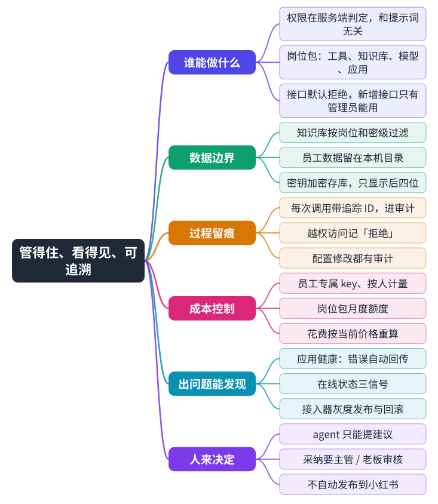

# 8 管控与安全

## 8.1 设计原则

| 原则 | 含义 |
|---|---|
| 管 agent，不管人 | 管理员看到的是 AI 助手的调用链路、用量和拦截，而不是员工屏幕 |
| 默认拒绝 | 控制台接口对老板和主管只开放白名单；新增接口默认只有管理员能用，忘了配置也不会泄露 |
| agent 只提建议，人来决定 | 改标准、改资料的最终决定权在主管或老板 |
| 故障降级而非中断 | 知识库、算力节点、网络任一出问题，主流程尽量继续，并留日志 |
| 先说清楚再动手 | 缺依赖、权限不足时给出可执行的说明，而不是悄悄失败 |

## 8.2 具体措施

- **身份**：自建账号，不接外部账号体系；员工首次登录须改初始密码；登录连续输错会被临时锁定；停用成员后其令牌 30 秒内失效。
- **密钥**：保存的密钥加密入库，接口和审计里只显示后四位。
- **审计**：控制台所有写操作都写审计，详情里不含密码和密钥；员工电脑上的错误回传前会去掉用户目录、令牌、邮箱、手机号和网址参数。
- **应用分发**：只执行中枢发布的版本，下载链接带签名且 10 分钟过期，员工端校验文件指纹，不安全的包路径会被拒绝。
- **接入器更新**：接入器自动更新自己，已做灰度发布与回滚，避免一次发错影响所有电脑。
- **采集边界**：只读、不自动发布、总开关默认关、有额度与冷静期。
